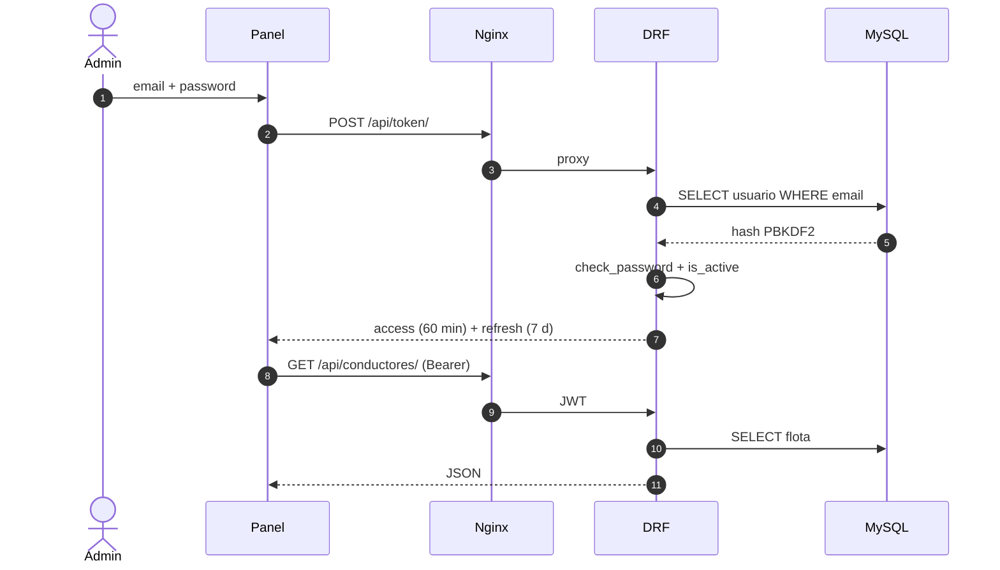

# Arquitectura CONATACOCH — Modelo 4+1

Documento de respaldo del README. Describe las cinco vistas, las decisiones de
arquitectura (ADR) y los atributos de calidad que las justifican.

---

## 1. Alcance y stakeholders

| Stakeholder | Interes principal |
|---|---|
| Gremio CONATACOCH | Operacion de recorridos, tarifas y flota |
| Conductores | Turnos, cupos y recepcion de pagos |
| Pasajeros | Buscar recorridos y pagar con QR |
| Administracion | Gestion de lineas, vehiculos y reportes |
| TI / DevOps | Disponibilidad, seguridad, costo y escalabilidad |
| Docencia | Trazabilidad con Modelo 4+1 y rubrica |

**Atributos de calidad priorizados**

| Atributo | Meta Fase 1 | Mecanismo |
|---|---|---|
| Escalabilidad | Backend N replicas sin sticky sessions | Stateless + JWT + Nginx DNS |
| Consistencia | Transacciones ACID en pagos | MySQL 3FN + `PROTECT` |
| Rendimiento de escritura | Miles de puntos GPS/min (F2) | MongoDB append-only + TTL |
| Seguridad | Sin secretos en reposo ni en respuestas | PBKDF2, Fernet, hash, JWT |
| Reproducibilidad | `up` desde cero | Imagen + seed idempotente |
| Observabilidad | Estado en un endpoint | `/api/health/` |

---

## 2. Vista Logica

### 2.1 Capas

```text
┌──────────────────────────────────────────────────────────────┐
│ Presentacion                                                 │
│  web-admin (Nginx + HTML/CSS/JS)     android-app (Fase 2)    │
└───────────────────────────┬──────────────────────────────────┘
                            │ HTTP / JSON
┌───────────────────────────▼──────────────────────────────────┐
│ Aplicacion                                                   │
│  Nginx proxy → Django URLconf → DRF ViewSets → Serializers   │
│  SimpleJWT · Throttling · OpenAPI · Paginacion               │
└───────────────────────────┬──────────────────────────────────┘
                            │ ORM / PyMongo
┌───────────────────────────▼──────────────────────────────────┐
│ Dominio                                                      │
│  Usuario · LineaColectiva · Vehiculo · Conductor ·           │
│  Paradero · TransaccionPago                                  │
│  Validadores RUT/patente · Cifrado OTP · Reglas CHECK        │
└───────────────────────────┬──────────────────────────────────┘
                            │
┌───────────────────────────▼──────────────────────────────────┐
│ Datos                                                        │
│  MySQL 8 (transaccional)      MongoDB Atlas (telemetria)     │
└──────────────────────────────────────────────────────────────┘
```

### 2.2 Modulos y dependencias

| Modulo | Depende de | Expone |
|---|---|---|
| `conatacoch.settings` | entorno | Configuracion global |
| `conatacoch.urls` | `core.urls`, JWT, spectacular | Rutas raiz |
| `core.models` | `core.crypto` | Entidades y reglas |
| `core.serializers` | `core.models` | Contratos JSON |
| `core.views` | serializers, models, mongo | Endpoints |
| `core.mongo` | PyMongo, settings | Pool e indices |
| `seed_conatacoch` | models, dataset | Datos iniciales |
| `web-admin` | API publica | Dashboard |

No hay dependencias circulares: el dominio no importa vistas ni drivers; la
capa de datos se inyecta por settings.

### 2.3 Modelo de dominio resumido

- **Usuario** es la identidad unica. El rol (`ADMIN`, `CONDUCTOR`, `CLIENTE`)
  discrimina capacidades sin duplicar credenciales.
- **LineaColectiva** es un itinerario autorizado, no un vehiculo. Un folio
  puede tener varios itinerarios y trazados.
- **Vehiculo** pertenece a una linea; **Conductor** opera un vehiculo y declara
  el folio de su turno.
- **Paradero** pertenece a una linea y tiene coordenadas.
- **TransaccionPago** relaciona pasajero, conductor y linea; su QR es un UUID
  unico.

---

## 3. Vista de Procesos

### 3.1 Arranque

```text
compose up
  ├─ db_mysql: init + healthcheck (mysqladmin ping)
  ├─ backend (depends_on healthy)
  │    ├─ wait_for_db (30 intentos x 2 s)
  │    ├─ migrate --noinput
  │    ├─ seed_conatacoch (transaccion atomica)
  │    ├─ init_mongo_indexes (no bloqueante)
  │    └─ gunicorn gthread (3 workers x 4 threads)
  ├─ web_admin: Nginx (depends_on backend)
  └─ mongo_local (solo perfil mongo-local)
```

**Por que el seed no bloquea si Mongo falla:** en Fase 1 los indices de
telemetria no son necesarios para servir el catalogo. El entrypoint registra la
advertencia y el health reporta `degraded`, evitando un crash-loop por una
dependencia externa opcional.

### 3.2 Solicitud de lectura

1. Nginx recibe la peticion y resuelve `backend` via DNS Docker.
2. Gunicorn la entrega a un thread del worker.
3. DRF aplica throttling anonimo/usuario y permisos.
4. El ViewSet construye el queryset con `select_related` cuando hay FK.
5. MySQL ejecuta el `SELECT` usando indices B-Tree.
6. El serializer produce JSON paginado.

### 3.3 Procesos de escritura (Fases futuras)

| Proceso | Consistencia | Almacen |
|---|---|---|
| Pago QR | Transaccion ACID + `PROTECT` | MySQL |
| Telemetria | Append-only, sin transaccion distribuida | Mongo |
| Turno de conductor | Update puntual | MySQL |
| Reconciliacion | Job batch idempotente | MySQL |

No se usa una transaccion distribuida MySQL↔Mongo: los datos de telemetria son
eventos independientes y toleran *eventual consistency*. Los pagos nunca
dependen de Mongo.

### 3.4 Concurrencia y bloqueo

- El seed usa `transaction.atomic()` y claves naturales unicas.
- Dos seeds concurrentes no duplican: la restriccion unica resuelve la carrera
  (el segundo actualiza).
- En multi-replica, migrar/sembrar debe ser un job unico previo.
- Los cupos de conductor se actualizaran con `select_for_update` en Fase 2.

---

## 4. Vista de Desarrollo

### 4.1 Organizacion del monorepo

| Carpeta | Contenido | Fase |
|---|---|---|
| `backend/` | Django, DRF, comandos, pruebas | 1 |
| `web-admin/` | Panel Nginx | 1 |
| `android-app/` | App Kotlin (reservado) | 2 |
| `docs/` | Arquitectura, datos, despliegue | 1 |
| raiz | Compose, env, dataset | 1 |

### 4.2 Estandares

- PEP 8, type hints en modulos nuevos, docstrings en espanol.
- Migraciones siempre versionadas; prohibido `--fake` en produccion.
- Configuracion por entorno; ningun secreto hardcodeado.
- Contratos de API documentados con `extend_schema`.
- Tests obligatorios para nuevas reglas de negocio.
- Imagen inmutable; no bind mounts en produccion.

### 4.3 Flujo de cambio de esquema

```text
models.py → makemigrations → revisar SQL → migrate → tests → seed → docs
```

Para MySQL, revisar el SQL con:

```bash
docker compose exec backend python manage.py sqlmigrate core 0001
```

### 4.4 Estrategia de pruebas

| Nivel | Herramienta | Alcance |
|---|---|---|
| Unitario | Django TestCase | Validadores, modelos, PROTECT |
| Integracion | Django TestCase + Client | Seed, API, JWT |
| Contrato | drf-spectacular | OpenAPI valido |
| Humo | curl/health | Contenedores y dependencias |
| Carga (F2) | k6/Locust | Lecturas y telemetria |

### 4.5 Deuda tecnica consciente

- Panel web sin build tooling (HTML/CSS/JS puro) para mantenerlo simple en F1.
- Sin Celery/Redis todavia; no hay tareas asincronas en F1.
- Sin blacklist JWT; se agrega en F2.
- Paraderos con centroides aproximados; se reemplazan por geocodificacion.

---

## 5. Vista Fisica

### 5.1 Nodos y red

- Una red bridge `conatacoch_net`; ningun servicio depende de `localhost` para
  comunicarse con otro.
- `web_admin` es el unico punto de entrada HTTP.
- `db_mysql` y `backend` no publican puertos en produccion.
- Volumenes nombrados sobreviven a `down` (sin `-v`).

### 5.2 Puertos

| Servicio | Interno | Host | Nota |
|---|---|---|---|
| web_admin | 80 | 8080 | Unico ingreso publico |
| backend | 8000 | — | Se accede via Nginx; `:8000` solo en dev |
| db_mysql | 3306 | 3306 | Solo inspeccion local |
| mongo_local | 27017 | 27017 | Solo perfil local |

### 5.3 Despliegue cloud sugerido

```text
Route 53 / Cloud DNS
        │
   ALB / WAF (TLS, 443)
        │
   ECS/EKS/Kubernetes  ── web_admin (Nginx) ── backend (N replicas)
        │                                            │
        │                              ┌─────────────┴─────────────┐
        │                              ▼                           ▼
        │                     RDS MySQL 8 Multi-AZ        MongoDB Atlas
        │                     + read replica              replica set / sharding
        └── CloudWatch / Prometheus + Grafana + Loki
```

Alternativa simple: una VM con Docker Compose + Caddy/Traefik para TLS y
backups programados.

### 5.4 Requisitos de recursos (referencia)

| Servicio | CPU | RAM | Disco |
|---|---|---|---|
| backend (por replica) | 0.5–1 vCPU | 512 MB–1 GB | imagen |
| MySQL | 2 vCPU | 4 GB | 50 GB SSD |
| web_admin | 0.1 vCPU | 64 MB | imagen |
| Mongo local (demo) | 1 vCPU | 1 GB | 20 GB |

---

## 6. Vista de Escenarios

| Escenario | Precondicion | Postcondicion | Vistas involucradas |
|---|---|---|---|
| E1 Login admin | Usuario semilla activo | JWT emitido, `last_login` actualizado | Logica, Procesos, Fisica |
| E2 Buscar recorrido | Dataset cargado | Lista paginada filtrada | Logica, Procesos |
| E3 Iniciar turno (F2) | Conductor con vehiculo | `en_turno=True`, cupos | Logica, Procesos, Datos |
| E4 Pagar QR (F3) | Pasajero + conductor | `TransaccionPago` PAGADO | Logica, Procesos |
| E5 Monitorear salud | Servicios arriba | JSON con latencias | Fisica, Procesos |
| E6 Recuperar entorno | Volumen borrado | Esquema + seed restaurados | Desarrollo, Fisica |

### E1 — Login y consulta autenticada



### E5 — Health degradado

1. `/api/health/` consulta MySQL (`SELECT 1`) y Mongo (`ping`).
2. Si MySQL falla → HTTP 503 (no hay servicio util).
3. Si solo Mongo falla → HTTP 200 con `status=degraded`.
4. El healthcheck de Docker usa `/api/health/live/` para no reiniciar el
   backend por una dependencia opcional.

---

## 7. Decisiones de arquitectura (ADR)

| ID | Decision | Alternativa descartada | Razon |
|---|---|---|---|
| ADR-01 | Usuario custom con `rol` | Tablas Admin/Conductor/Cliente | Una identidad, sin duplicar passwords |
| ADR-02 | MySQL + MongoDB | Solo MySQL | Telemetria write-heavy y geoespacial |
| ADR-03 | Clave `(folio, nombre, tipo_trazado)` | `folio` unico | Dataset real tiene 660 filas y 396 folios |
| ADR-04 | JWT + sesiones DB | Sesiones en memoria | Stateless y escalable |
| ADR-05 | Backend sin puerto publicado | Publicar 8000 | Permite `--scale backend=N` |
| ADR-06 | PyMySQL | mysqlclient | Imagen slim sin toolchain nativo |
| ADR-07 | TTL 4 h en telemetria | Guardar historico infinito | Costo y privacidad; historico en F3 |
| ADR-08 | Contenedor read-only | FS escribible | Integridad y seguridad |
| ADR-09 | Swagger sidecar | CDN publico | Funciona sin Internet y con CSP estricta |
| ADR-10 | Paraderos por centroide | Sin paraderos | Demo georreferenciada; reemplazable |

### Riesgos y mitigacion

| Riesgo | Impacto | Mitigacion |
|---|---|---|
| Atlas no disponible | Health degradado | Reintentos, fallback local, alertas |
| Seed en cada arranque | Arranque lento | `--skip-paraderos`, job unico, `SEED_ON_START=false` en escala |
| MySQL cuello de botella | Latencia | Indices, replicas de lectura, pooler |
| Crecimiento de telemetria | Costo | TTL, time series, sharding por folio |
| Rotacion de `SECRET_KEY` | OTP ilegible | Mover a KMS en produccion |
| Demo passwords debiles | Acceso no autorizado | Rotacion obligatoria |

---

## 8. Evolucion prevista

```text
F1  Infra + datos + seed + indices          (actual)
F2  Ingesta de telemetria, WebSocket, Android, Redis
F3  Pagos QR, conciliacion, reporteria, read replicas
F4  Multi-region, sharding, observabilidad avanzada
```

La separacion actual (dominio / aplicacion / datos) permite incorporar F2 y F3
sin reescribir la base: solo se agregan endpoints, consumidores y tablas
auxiliares.
