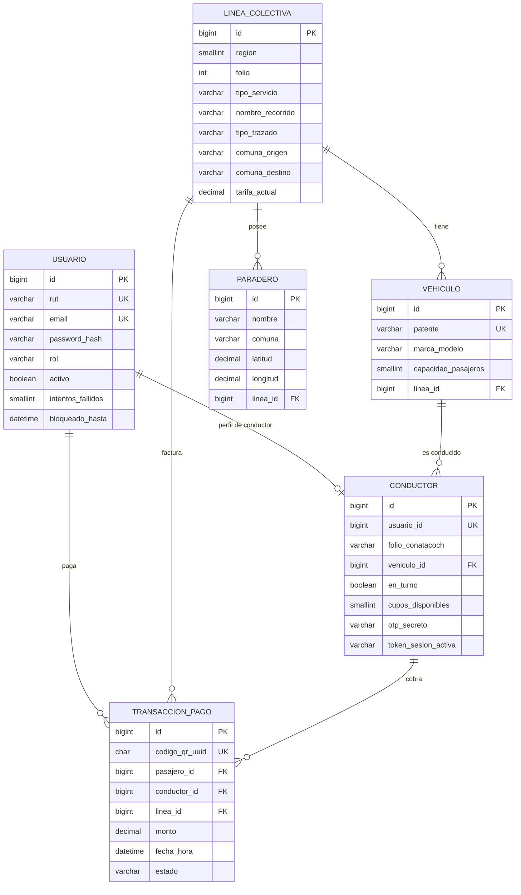

# Modelo de datos CONATACOCH

Referencia del esquema relacional (MySQL 8, 3FN) y documental (MongoDB Atlas).

---

## 1. Diagrama entidad-relacion



> MySQL almacena `UUIDField` como `CHAR(32)`; los `BooleanField` como
> `TINYINT(1)`; los `DateTimeField` como `DATETIME(6)` en UTC.

---

## 2. Diccionario de datos

### 2.1 `usuario`

| Campo | Tipo | Nulo | Clave / indice | Descripcion |
|---|---|---|---|---|
| `id` | BIGINT UNSIGNED | No | PK | Surrogate |
| `rut` | VARCHAR(12) | No | UNIQUE B-Tree | RUT con DV, validado modulo 11 |
| `nombre` | VARCHAR(150) | No | — | Nombre completo |
| `email` | VARCHAR(254) | No | UNIQUE B-Tree | `USERNAME_FIELD` |
| `password_hash` | VARCHAR(128) | No | — | PBKDF2-SHA256 de Django |
| `rol` | VARCHAR(10) | No | INDEX | `ADMIN`, `CONDUCTOR`, `CLIENTE` |
| `activo` | TINYINT(1) | No | compuesto | Habilita login |
| `intentos_fallidos` | SMALLINT UNSIGNED | No | — | Contador de fuerza bruta |
| `bloqueado_hasta` | DATETIME(6) | Si | INDEX | Fin del bloqueo temporal |
| `is_staff` | TINYINT(1) | No | — | Acceso a Django Admin |
| `is_superuser` | TINYINT(1) | No | — | Permisos totales |
| `date_joined` | DATETIME(6) | No | — | Alta |
| `last_login` | DATETIME(6) | Si | — | Ultimo acceso (SimpleJWT) |

Indices: `idx_usuario_rol_activo (rol, activo)`,
`idx_usuario_bloqueado (bloqueado_hasta)`, unicos por `rut` y `email`.

### 2.2 `linea_colectiva`

| Campo | Tipo | Nulo | Clave / indice | Descripcion |
|---|---|---|---|---|
| `id` | BIGINT UNSIGNED | No | PK | Surrogate |
| `region` | SMALLINT UNSIGNED | No | INDEX + CHECK ≥ 1 | Region (13 = RM) |
| `folio` | INT UNSIGNED | No | INDEX + CHECK ≥ 1 | Folio oficial del servicio |
| `tipo_servicio` | VARCHAR(80) | No | INDEX | Urbano / rural |
| `nombre_recorrido` | VARCHAR(50) | No | UNIQUE compuesto | Itinerario |
| `tipo_trazado` | VARCHAR(20) | No | UNIQUE compuesto | PRINCIPAL / ALTERNATIVO |
| `nombre_origen` | VARCHAR(150) | No | — | Nombre del origen |
| `comuna_origen` | VARCHAR(100) | No | INDEX | Comuna de origen |
| `domicilio_origen` | VARCHAR(200) | No | — | Direccion/circunvalacion |
| `nombre_destino` | VARCHAR(150) | No | — | Nombre del destino |
| `comuna_destino` | VARCHAR(100) | No | INDEX | Comuna de destino |
| `domicilio_destino` | VARCHAR(200) | No | — | Direccion/circunvalacion |
| `tarifa_actual` | DECIMAL(10,2) | No | CHECK ≥ 0 | Tarifa vigente CLP |

Restriccion: `UNIQUE (folio, nombre_recorrido, tipo_trazado)`.

### 2.3 `vehiculo`

| Campo | Tipo | Nulo | Clave / indice | Descripcion |
|---|---|---|---|---|
| `id` | BIGINT UNSIGNED | No | PK | Surrogate |
| `patente` | VARCHAR(10) | No | UNIQUE B-Tree | Patente chilena |
| `marca_modelo` | VARCHAR(120) | No | — | Marca y modelo |
| `capacidad_pasajeros` | SMALLINT UNSIGNED | No | CHECK 1–30 | Cupos teoricos |
| `linea_id` | BIGINT UNSIGNED | No | FK → linea, INDEX | Linea asignada |

### 2.4 `conductor`

| Campo | Tipo | Nulo | Clave / indice | Descripcion |
|---|---|---|---|---|
| `id` | BIGINT UNSIGNED | No | PK | Surrogate |
| `usuario_id` | BIGINT UNSIGNED | No | UNIQUE, FK → usuario | Perfil 1:1 |
| `folio_conatacoch` | VARCHAR(20) | No | INDEX | Folio operativo del turno |
| `vehiculo_id` | BIGINT UNSIGNED | No | FK → vehiculo, INDEX | Vehiculo asignado |
| `en_turno` | TINYINT(1) | No | INDEX | Disponibilidad |
| `cupos_disponibles` | SMALLINT UNSIGNED | No | CHECK 0–30 | Cupos ofrecidos |
| `otp_secreto` | VARCHAR(255) | No | — | Secreto TOTP cifrado Fernet |
| `token_sesion_activa` | VARCHAR(128) | No | — | SHA-256 del token de sesion |

### 2.5 `paradero`

| Campo | Tipo | Nulo | Clave / indice | Descripcion |
|---|---|---|---|---|
| `id` | BIGINT UNSIGNED | No | PK | Surrogate |
| `nombre` | VARCHAR(160) | No | UNIQUE compuesto | Nombre del paradero |
| `comuna` | VARCHAR(100) | No | INDEX | Comuna |
| `latitud` | DECIMAL(9,6) | No | INDEX compuesto | −90 a 90 |
| `longitud` | DECIMAL(9,6) | No | INDEX compuesto | −180 a 180 |
| `linea_id` | BIGINT UNSIGNED | No | FK → linea, INDEX | Linea |

Restriccion: `UNIQUE (linea_id, nombre)` y `CHECK` de coordenadas.

### 2.6 `transaccion_pago`

| Campo | Tipo | Nulo | Clave / indice | Descripcion |
|---|---|---|---|---|
| `id` | BIGINT UNSIGNED | No | PK | Surrogate |
| `codigo_qr_uuid` | CHAR(32) | No | UNIQUE B-Tree | UUID del QR |
| `pasajero_id` | BIGINT UNSIGNED | No | FK → usuario, INDEX | Cliente que paga |
| `conductor_id` | BIGINT UNSIGNED | No | FK → conductor, INDEX | Cobrador |
| `linea_id` | BIGINT UNSIGNED | No | FK → linea, INDEX | Linea del viaje |
| `monto` | DECIMAL(12,2) | No | CHECK ≥ 0 | Monto CLP |
| `fecha_hora` | DATETIME(6) | No | INDEX | UTC |
| `estado` | VARCHAR(10) | No | INDEX | PENDIENTE/PAGADO/ANULADO/EXPIRADO |

---

## 3. Prueba de 3FN

### 3.1 Primera forma normal (1FN)

Todos los campos son atomicos. No existen columnas con listas (por ejemplo,
"paraderos: A,B,C") ni tablas anidadas. Cada paradero es una fila propia.

### 3.2 Segunda forma normal (2FN)

- La PK surrogate `id` es un atributo simple; no hay claves compuestas en la PK.
- La clave natural de `linea_colectiva` es compuesta y se declara como
  restriccion unica. Todos los atributos (origen, destino, tarifa, etc.)
  dependen del itinerario completo, no de una parte.
- No hay atributos que dependan solo de `folio` o solo de `nombre_recorrido`.

### 3.3 Tercera forma normal (3FN)

- No se guarda el nombre de la linea en `vehiculo`, `conductor` o
  `transaccion_pago`; solo la FK.
- No se guarda la comuna de la linea en el paradero mas alla de su propio
  atributo descriptivo (el paradero puede estar en otra comuna del recorrido).
- No hay dependencias transitivas como `linea_id → comuna_origen → region`.
- `tarifa_actual` es un valor vigente; el historico seria una tabla
  `tarifa_historial` (Fase 3), no columnas repetidas.

### 3.4 Casos discutibles

| Caso | Analisis | Decision |
|---|---|---|
| `Conductor.folio_conatacoch` vs `Vehiculo.linea.folio` | El folio del turno puede cambiar por relevo; es un dato operativo | Se mantiene como atributo propio |
| `LineaColectiva.comuna_origen/destino` | Son atributos descriptivos del recorrido | Se mantienen; no se normaliza a tabla de comunas en F1 |
| `tarifa_actual` | Dato vigente, no historico | Tabla de historial en F3 |
| `Paradero.comuna` | Podria derivarse de coordenadas | Se almacena para filtros y demos; se validara con geocoding |

---

## 4. Catalogo de indices

| Tabla | Indice | Columnas | Tipo | Consulta que optimiza |
|---|---|---|---|---|
| usuario | `rut` | rut | UNIQUE B-Tree | Login por RUT |
| usuario | `email` | email | UNIQUE B-Tree | Login por email |
| usuario | `idx_usuario_rol_activo` | rol, activo | B-Tree | Listar conductores activos |
| usuario | `idx_usuario_bloqueado` | bloqueado_hasta | B-Tree | Desbloqueo/barrido |
| linea | `idx_linea_region_folio` | region, folio | B-Tree | Filtrar RM + folio |
| linea | `idx_linea_comuna_origen` | comuna_origen | B-Tree | Buscar por origen |
| linea | `idx_linea_comuna_destino` | comuna_destino | B-Tree | Buscar por destino |
| linea | `uq_linea_folio_recorrido_traza` | folio, nombre, tipo | UNIQUE | Integridad del dataset |
| vehiculo | `patente` | patente | UNIQUE B-Tree | Busqueda por patente |
| vehiculo | `idx_vehiculo_linea` | linea_id | B-Tree | Flota por linea |
| conductor | `idx_conductor_folio` | folio_conatacoch | B-Tree | Buscar conductor |
| conductor | `idx_conductor_turno` | en_turno, folio | B-Tree | Conductores en turno |
| conductor | `idx_conductor_vehiculo` | vehiculo_id, en_turno | B-Tree | Vehiculo disponible |
| paradero | `uq_paradero_linea_nombre` | linea_id, nombre | UNIQUE | Evitar duplicados |
| paradero | `idx_paradero_comuna_linea` | comuna, linea_id | B-Tree | Paraderos por comuna |
| paradero | `idx_paradero_geo` | latitud, longitud | B-Tree | Caja delimitadora simple |
| pago | `codigo_qr_uuid` | codigo_qr_uuid | UNIQUE B-Tree | Validar QR |
| pago | `idx_pago_conductor_fecha` | conductor_id, fecha_hora | B-Tree | Recaudacion por conductor |
| pago | `idx_pago_linea_fecha` | linea_id, fecha_hora | B-Tree | Recaudacion por linea |
| pago | `idx_pago_pasajero_fecha` | pasajero_id, fecha_hora | B-Tree | Historial del pasajero |
| pago | `idx_pago_estado_fecha` | estado, fecha_hora | B-Tree | Conciliacion pendientes |

> Los indices compuestos respetan el orden: primero el filtro de igualdad y
> luego el rango/orden. Para busquedas geoespaciales reales en MySQL se puede
> agregar `SPATIAL INDEX` en Fase 2; en F1 el calculo geoespacial vive en Mongo.

---

## 5. Integridad y acciones referenciales

| FK | Accion | Efecto |
|---|---|---|
| `vehiculo.linea_id` | PROTECT / RESTRICT | No se borra una linea con flota |
| `conductor.usuario_id` | PROTECT / RESTRICT | No se borra un usuario con perfil |
| `conductor.vehiculo_id` | PROTECT / RESTRICT | No se borra un vehiculo asignado |
| `paradero.linea_id` | PROTECT / RESTRICT | No se borra una linea con paraderos |
| `transaccion_pago.*` | PROTECT / RESTRICT | No se borra historial financiero |

Django implementa `PROTECT` en el ORM; MySQL/InnoDB aplica `RESTRICT` por
defecto en el motor. La suite de pruebas verifica `ProtectedError`.

Otras reglas:

- RUT valido (modulo 11) y unico.
- Patente con formato chileno.
- Montos/tarifas no negativos.
- Coordenadas dentro de rango.
- Estados de pago acotados por `choices`.
- QR unico por transaccion.

---

## 6. MongoDB `telemetria_ubicacion`

### 6.1 Documento

```json
{
  "_id": { "$oid": "6730a1..." },
  "id_vehiculo": 1,
  "id_conductor": 1,
  "folio_linea": "234001",
  "cupos_disponibles": 3,
  "ubicacion": { "type": "Point", "coordinates": [-70.6483, -33.4569] },
  "velocidad_kmh": 42.0,
  "rumbo": 180.0,
  "timestamp": { "$date": "2026-11-21T18:00:00.000Z" }
}
```

| Campo | Tipo BSON | Obligatorio | Descripcion |
|---|---|---|---|
| `id_vehiculo` | Int | Si | FK logica a MySQL |
| `id_conductor` | Int | Si | FK logica a MySQL |
| `folio_linea` | String | Si | Folio del servicio |
| `cupos_disponibles` | Int | Si | Oferta en tiempo real |
| `ubicacion` | GeoJSON Point | Si | `[longitud, latitud]` |
| `velocidad_kmh` | Double | Si | 0–200 aprox. |
| `rumbo` | Double | Si | 0–360 grados |
| `timestamp` | Date | Si | UTC, indexado TTL |

No se embeben datos personales del conductor (solo su id), minimizando la
exposicion. La retencion de 4 horas reduce el costo y el riesgo.

### 6.2 Indices

```javascript
db.ubicaciones.createIndex(
  { ubicacion: "2dsphere" },
  { name: "idx_ubicacion_2dsphere" }
);
db.ubicaciones.createIndex(
  { folio_linea: 1, timestamp: -1 },
  { name: "idx_folio_timestamp" }
);
db.ubicaciones.createIndex(
  { timestamp: 1 },
  { name: "idx_timestamp_ttl", expireAfterSeconds: 14400 }
);
db.ubicaciones.createIndex(
  { id_vehiculo: 1, timestamp: -1 },
  { name: "idx_vehiculo_timestamp" }
);
```

### 6.3 Consultas de referencia

Ultima posicion de un recorrido:

```javascript
db.ubicaciones.find({ folio_linea: "234001" })
  .sort({ timestamp: -1 }).limit(1);
```

Vehiculos en 2 km:

```javascript
db.ubicaciones.find({
  ubicacion: {
    $near: {
      $geometry: { type: "Point", coordinates: [-70.6483, -33.4569] },
      $maxDistance: 2000
    }
  }
});
```

Cupos disponibles por folio (ultimo evento):

```javascript
db.ubicaciones.aggregate([
  { $match: { folio_linea: "234001" } },
  { $sort: { timestamp: -1 } },
  { $group: { _id: "$id_vehiculo", cupos: { $first: "$cupos_disponibles" },
               ubicacion: { $first: "$ubicacion" } } }
]);
```

### 6.4 Operacion

- **Pool:** `maxPoolSize=50`, `minPoolSize=5` por proceso.
- **Retencion:** TTL 14.400 s (4 h). El monitor TTL corre cada ~60 s.
- **Escritura:** `insert_one` con `retryWrites=true`; telemetria tolera
  reintentos idempotentes por `timestamp` en F2.
- **Seguridad Atlas:** usuario dedicado, TLS obligatorio, allowlist de IP/VPC,
  backups continuos.
- **Cambio de TTL:** usar `collMod`; no recrear el indice con otra opcion.

---

## 7. Mapeo dataset → `linea_colectiva`

| JSON | Modelo |
|---|---|
| `REGION` | `region` |
| `FOLIO` | `folio` |
| `TIPO_SERVICIO` | `tipo_servicio` |
| `NOMBRE_RECORRIDO` | `nombre_recorrido` |
| `TIPO_TRAZADO` | `tipo_trazado` |
| `NOMBRE_ORIGEN` | `nombre_origen` |
| `COMUNA_ORIGEN` | `comuna_origen` |
| `DOMICILIO_ORIGEN` | `domicilio_origen` |
| `NOMBRE_DESTINO` | `nombre_destino` |
| `COMUNA_DESTINO` | `comuna_destino` |
| `DOMICILIO_DESTINO` | `domicilio_destino` |
| (calculado) | `tarifa_actual` segun tipo de servicio |

**Perfil del dataset**

| Metrica | Valor |
|---|---|
| Filas | 660 |
| Folios unicos | 396 |
| Comunas distintas | 48 |
| Pares `(folio, nombre)` | 617 |
| Tripletas `(folio, nombre, tipo)` | 660 |
| Regiones | 13 (Metropolitana) |

**Paraderos generados:** 2 por linea (origen y destino), 1.320 en total.
Coordenadas = centroide de comuna + jitter deterministico ±0,01°.

---

## 8. Operaciones de esquema

```bash
# Aplicar migraciones
docker compose exec backend python manage.py migrate

# Ver SQL generado
docker compose exec backend python manage.py sqlmigrate core 0001

# Verificar que no haya cambios sin migrar
docker compose exec backend python manage.py makemigrations --check --dry-run

# Exportar/restaurar MySQL
docker compose exec db_mysql mysqldump -uconatacoch -p conatacoch > backup.sql
docker compose exec -T db_mysql mysql -uconatacoch -p conatacoch < backup.sql
```

**Politica de cambios**

1. Nunca editar una migracion ya aplicada en produccion.
2. Agregar migraciones nuevas y probarlas en una copia.
3. Para columnas grandes usar migraciones en dos pasos (nullable → backfill →
   not null).
4. Mantener los indices alineados con las consultas reales (revisar
   `EXPLAIN`).
